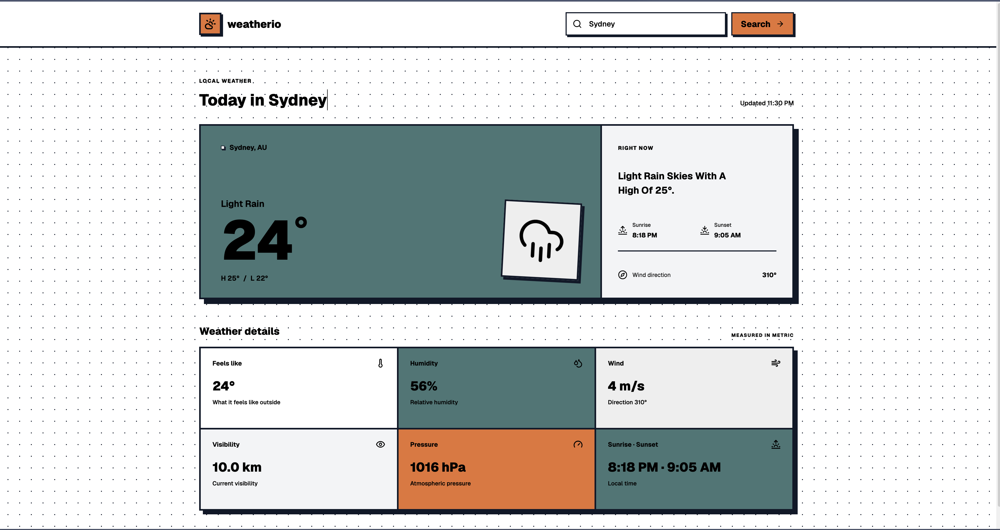

<h1>Weatherio<h1>
<h2>A weather reporting app that returns weather conditions for different locations fetched from the openweather Api</h2>

<ul>
<li>Places can be searched up in order to retrieve weather data about the location</li>
</ul>

## API key setup

Create a `.env` file in the project root and set your OpenWeather API key:

```env
VITE_OPENWEATHER_API_KEY=your_openweather_api_key
```

Restart the development server after changing the key. Vite exposes `VITE_` variables to browser code, so this key is included in the client and should not be treated as a secret.
